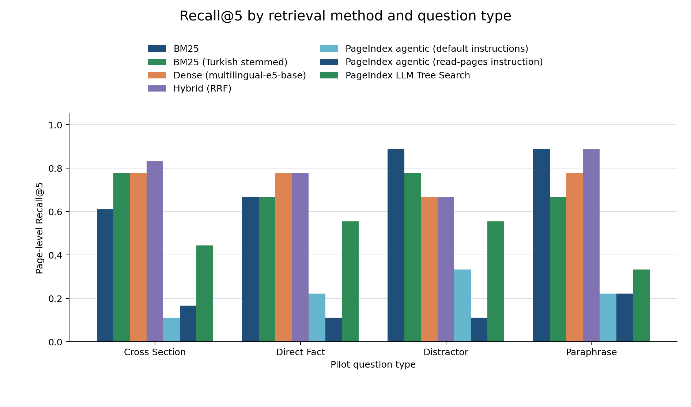

# DocBenchTR

**A pilot benchmark for retrieval on long, structured Turkish documents**<br>
Ümit Altınöz · Beykent University

DocBenchTR is a research proposal comparing retrieval methods for retrieval-augmented generation (RAG) over Turkish documents with explicit articles, sections, and cross-references. Turkish is underrepresented in common retrieval evaluations, while legal and institutional documents often require finding a provision by meaning and structure rather than by a repeated keyword.

This public pilot reports retrieval only. It evaluates physical PDF pages as retrieval units so results are comparable across methods with different internal indexes. It does not generate answers or assess answer faithfulness.

## Methods

- **BM25:** lexical page ranking.
- **BM25 (Turkish stemmed):** Snowball Turkish stemming before lexical ranking.
- **Dense:** `intfloat/multilingual-e5-base`, with query and passage prefixes.
- **Hybrid (RRF):** reciprocal rank fusion of the unstemmed BM25 and dense rankings.
- **PageIndex agentic (default instructions):** the [PageIndex](https://github.com/VectifyAI/PageIndex) local SDK uses its built-in instructions with `qwen2.5:7b-instruct` through LiteLLM's `ollama_chat/` route for tool-using chat/search.
- **PageIndex agentic (read-pages instruction):** the same SDK with our additional retrieval instruction requiring a successful `get_page_content` result before answering. This is an explicit modification of the default agentic method. For both rows, `tool_call_count` counts every tool call; only successful `get_page_content` results contribute pages to its ranking.
- **PageIndex LLM Tree Search:** gives the local model the cached PageIndex tree (titles, node IDs, inclusive physical page ranges, and summaries) plus the question. It requests `{"thinking": ..., "node_list": [...]}` with Ollama JSON-schema output. The ranking expands each selected node's inclusive `start_index..end_index` range in returned `node_list` order and deduplicates pages by first occurrence. Parse failures remain in the per-query results as failed rows.

All methods return ranked, one-based physical PDF page numbers. The dense model uses CUDA when available and otherwise runs on CPU; the actual device is written to the generated results.

## Pilot setup

The pipeline downloads three openly published Turkish legal documents, checks each file against its pinned SHA-256 snapshot, and records the fetched source URL and digest in [`data/sources.json`](data/sources.json). It extracts text by physical page, drafts questions from article text, and checks every answer span against the cited extracted page before retrieval evaluation. The kept questions are in [`data/pilot_questions.json`](data/pilot_questions.json); the per-question article and page verification log is in [`data/question_verification.json`](data/question_verification.json). Failed drafts are excluded. The question set is labelled **pilot set, auto-drafted from source text, span-verified; not yet human-reviewed**.

The question types are direct fact, paraphrase, cross-section (two articles), and distractor (overlapping wording elsewhere in the document). Each method is evaluated within the question's source document. The candidate relevance set is the exact source page or pages in `source_pages`.

Source PDFs are downloaded to `data/raw/` and are intentionally excluded from Git. Their legal texts are officially published and may be reused under the official-text provision of the Turkish Copyright Act; `data/sources.json` retains each source's reuse note and links. The PDFs are snapshots, not a claim that the text reflects current law. The archived KVKK PDF reflects the text available in two thousand twenty, and the Consumer Protection PDF is an agency-hosted January edition from two thousand twenty-one. Consult the source agency for authoritative current wording.

### Reproduce

Requires Python three point twelve, `uv`, an Xpdf or Poppler `pdftotext` executable on `PATH`, an internet connection for source PDFs and the embedding model, and a CUDA-capable PyTorch install for GPU embedding. The project pins runtime dependencies and selects the CUDA twelve point six PyTorch wheel. The actual extractor version is stored in `data/sources.json`.

```powershell
uv sync --group dev
uv run python -m docbenchtr.run_pilot
```

The run regenerates the verified question set, CSV and JSON results, the chart, and the results block in this README. To download and hash only the source documents, run `uv run python scripts/download_docs.py`.

For PageIndex, install and start Ollama locally and pull `qwen2.5:7b-instruct` before running the pilot. Both agentic variants use the SDK's tool definitions through LiteLLM's `ollama_chat/` route and share the local cached trees under `.pageindex/docbenchtr-pilot/`. PageIndex LLM Tree Search sends the cached tree and question to Ollama's `/api/chat` endpoint with a JSON schema. These methods make no cloud calls. The pipeline checks the local tags endpoint and records per-query failures.

## Results

The generated table and chart below are populated from the run's `results/summary.json`. Per-query values are in [`results/results.csv`](results/results.csv) and [`results/per_query.json`](results/per_query.json).

> **Correction history.** An earlier version of this table (2026-10-16) published PageIndex rows produced while Ollama served the model with its default 4,096-token context window, which silently truncated PageIndex prompts. Those rows were invalid and have been replaced. The current run serves the model with a 32,768-token context (`OLLAMA_CONTEXT_LENGTH=32768`, `num_ctx 32768`) and caps each response at 4,096 tokens; the PageIndex trees and node summaries were rebuilt under the same setting. Recorded PageIndex inputs now exceed 4,096 tokens (up to ~16,400 for one tree-search prompt and ~76,000 cumulative for one agentic query). In the first pass, 8 LLM Tree Search queries hit a 180 s client HTTP timeout; they were re-run with an 1,800 s timeout (`python -m docbenchtr.rerun_failed`) and the re-run is recorded in `results/summary.json`. The BM25 / Dense / Hybrid rows are unchanged.

## How to read the PageIndex rows

These rows are **not a verdict on PageIndex**. Every PageIndex variant here runs on `qwen2.5:7b-instruct`, a small local model, on an 8 GB laptop GPU (RTX 3070 Laptop) where the model plus a 32k context does not fully fit, so part of it runs on the CPU and long agentic queries take minutes. PageIndex's own documentation recommends the strongest chat model you can afford. What the pilot does show, at this scale:

- **Agentic mode reads pages only some of the time.** In 14 of 36 queries (default instructions) and 12 of 36 (read-pages instruction), the model finished without calling `get_page_content`, so those rankings are empty and score zero. Where it did read pages, its rankings still trail the classical baselines.
- **LLM Tree Search is the strongest PageIndex variant but trails the classical baselines** (Recall@5 0.472 vs 0.792 for Hybrid), and it is several orders of magnitude slower.
- Queries a method attempted but could not answer are **counted as zero, not dropped**; the coverage columns show how many.
- The laptop GPU is not the cause: the same configuration re-run on a Colab A100 gives the same overall picture (see [Hardware control](#hardware-control-colab-a100) below). A run with larger, current models is planned to separate model capacity from method design.

Whether PageIndex closes this gap with a frontier model is exactly the question the full DocBenchTR study is designed to answer.

<!-- GENERATED:START -->
## Pilot results

This generated section reads its metrics from `results/summary.json` (per-question records: `results/results.csv` and `results/per_query.json`).

| Method | Attempted | Scored | Zero ranking | Excluded | Recall@1 | Recall@3 | Recall@5 | MRR | Mean query latency |
|---|---:|---:|---:|---:|---:|---:|---:|---:|---:|
| BM25 | 36 | 36 | 0 | 0 | 0.278 | 0.653 | 0.764 | 0.532 | 2.370 ms |
| BM25 (Turkish stemmed) | 36 | 36 | 0 | 0 | 0.250 | 0.708 | 0.722 | 0.526 | 3.233 ms |
| Dense (multilingual-e5-base) | 36 | 36 | 0 | 0 | 0.403 | 0.667 | 0.750 | 0.627 | 652.390 ms |
| Hybrid (RRF) | 36 | 36 | 0 | 0 | 0.333 | 0.708 | 0.792 | 0.612 | 17.549 ms |
| PageIndex agentic (default instructions) | 36 | 36 | 14 | 0 | 0.167 | 0.222 | 0.222 | 0.218 | 273792.557 ms |
| PageIndex agentic (read-pages instruction) | 36 | 36 | 12 | 0 | 0.097 | 0.125 | 0.153 | 0.131 | 234038.412 ms |
| PageIndex LLM Tree Search | 36 | 36 | 0 | 0 | 0.278 | 0.375 | 0.472 | 0.396 | 48581.440 ms |



### Metrics by question type

| Method | Question type | Attempted | Scored | Zero ranking | Excluded | Recall@1 | Recall@3 | Recall@5 | MRR | Mean query latency |
|---|---|---:|---:|---:|---:|---:|---:|---:|---:|---:|
| BM25 | cross section | 9 | 9 | 0 | 0 | 0.111 | 0.500 | 0.611 | 0.500 | 2.159 ms |
| BM25 | direct fact | 9 | 9 | 0 | 0 | 0.444 | 0.667 | 0.667 | 0.564 | 2.898 ms |
| BM25 | distractor | 9 | 9 | 0 | 0 | 0.222 | 0.667 | 0.889 | 0.488 | 2.387 ms |
| BM25 | paraphrase | 9 | 9 | 0 | 0 | 0.333 | 0.778 | 0.889 | 0.578 | 2.035 ms |
| BM25 (Turkish stemmed) | cross section | 9 | 9 | 0 | 0 | 0.111 | 0.722 | 0.778 | 0.574 | 3.278 ms |
| BM25 (Turkish stemmed) | direct fact | 9 | 9 | 0 | 0 | 0.444 | 0.667 | 0.667 | 0.582 | 3.324 ms |
| BM25 (Turkish stemmed) | distractor | 9 | 9 | 0 | 0 | 0.111 | 0.778 | 0.778 | 0.452 | 3.508 ms |
| BM25 (Turkish stemmed) | paraphrase | 9 | 9 | 0 | 0 | 0.333 | 0.667 | 0.667 | 0.495 | 2.822 ms |
| Dense (multilingual-e5-base) | cross section | 9 | 9 | 0 | 0 | 0.278 | 0.667 | 0.778 | 0.741 | 702.593 ms |
| Dense (multilingual-e5-base) | direct fact | 9 | 9 | 0 | 0 | 0.444 | 0.556 | 0.778 | 0.563 | 442.623 ms |
| Dense (multilingual-e5-base) | distractor | 9 | 9 | 0 | 0 | 0.333 | 0.667 | 0.667 | 0.524 | 697.825 ms |
| Dense (multilingual-e5-base) | paraphrase | 9 | 9 | 0 | 0 | 0.556 | 0.778 | 0.778 | 0.682 | 766.519 ms |
| Hybrid (RRF) | cross section | 9 | 9 | 0 | 0 | 0.222 | 0.500 | 0.833 | 0.667 | 20.249 ms |
| Hybrid (RRF) | direct fact | 9 | 9 | 0 | 0 | 0.444 | 0.778 | 0.778 | 0.614 | 15.268 ms |
| Hybrid (RRF) | distractor | 9 | 9 | 0 | 0 | 0.222 | 0.667 | 0.667 | 0.488 | 17.423 ms |
| Hybrid (RRF) | paraphrase | 9 | 9 | 0 | 0 | 0.444 | 0.889 | 0.889 | 0.678 | 17.258 ms |
| PageIndex agentic (default instructions) | cross section | 9 | 9 | 3 | 0 | 0.111 | 0.111 | 0.111 | 0.222 | 397507.210 ms |
| PageIndex agentic (default instructions) | direct fact | 9 | 9 | 3 | 0 | 0.222 | 0.222 | 0.222 | 0.222 | 239089.147 ms |
| PageIndex agentic (default instructions) | distractor | 9 | 9 | 4 | 0 | 0.111 | 0.333 | 0.333 | 0.204 | 285612.757 ms |
| PageIndex agentic (default instructions) | paraphrase | 9 | 9 | 4 | 0 | 0.222 | 0.222 | 0.222 | 0.222 | 172961.116 ms |
| PageIndex agentic (read-pages instruction) | cross section | 9 | 9 | 3 | 0 | 0.056 | 0.167 | 0.167 | 0.167 | 313625.332 ms |
| PageIndex agentic (read-pages instruction) | direct fact | 9 | 9 | 3 | 0 | 0.000 | 0.000 | 0.111 | 0.022 | 185928.940 ms |
| PageIndex agentic (read-pages instruction) | distractor | 9 | 9 | 3 | 0 | 0.111 | 0.111 | 0.111 | 0.111 | 299557.438 ms |
| PageIndex agentic (read-pages instruction) | paraphrase | 9 | 9 | 3 | 0 | 0.222 | 0.222 | 0.222 | 0.222 | 137041.937 ms |
| PageIndex LLM Tree Search | cross section | 9 | 9 | 0 | 0 | 0.222 | 0.389 | 0.444 | 0.500 | 32095.740 ms |
| PageIndex LLM Tree Search | direct fact | 9 | 9 | 0 | 0 | 0.333 | 0.444 | 0.556 | 0.417 | 61338.217 ms |
| PageIndex LLM Tree Search | distractor | 9 | 9 | 0 | 0 | 0.444 | 0.444 | 0.556 | 0.467 | 32511.824 ms |
| PageIndex LLM Tree Search | paraphrase | 9 | 9 | 0 | 0 | 0.111 | 0.222 | 0.333 | 0.201 | 68379.981 ms |

### Run metadata

- Documents: 3 — Kişisel Verilerin Korunması Kanunu, Tüketicinin Korunması Hakkında Kanun ve İkincil Mevzuatı (Ocak 2021), Yükseköğretim Kanunu.
- Span-verified pilot questions: 36; excluded after verification: 0.
- Physical PDF pages extracted: 500 across kvkk_6698: 18, tuketicinin_korunmasi_6502: 340, yuksekogretim_2547: 142.
- Embedding model: `intfloat/multilingual-e5-base` revision `d128750597153bb5987e10b1c3493a34e5a4502a` on `cuda`.
- Question set label: **pilot set, auto-drafted from source text, span-verified; not yet human-reviewed**.
- PageIndex agentic (default instructions) queries: 36 attempted, 36 scored, 14 zero-ranking, 0 excluded.
- PageIndex agentic (read-pages instruction) queries: 36 attempted, 36 scored, 12 zero-ranking, 0 excluded.
- PageIndex agentic (default instructions) token counts: available for 36 queries; 1012135 input and 27926 output tokens total.
- PageIndex agentic (read-pages instruction) token counts: available for 36 queries; 982424 input and 25060 output tokens total.
- PageIndex LLM Tree Search queries: 36 attempted, 36 scored, 0 zero-ranking, 0 excluded; 0 parse failures.
- PageIndex LLM HTTP safety net: retry a request after 30 minutes without response progress, up to 3 retries; 0 retries recorded; there is no total index or query deadline.

### PageIndex index builds

- `kvkk_6698`: reused; build cached; prior build time unavailable; `toc_source=detected`; cache validation 12.1 s
- `tuketicinin_korunmasi_6502`: reused; build cached; prior build time unavailable; `toc_source=detected`; cache validation 4.5 s
- `yuksekogretim_2547`: reused; build cached; prior build time unavailable; `toc_source=detected`; cache validation 4.0 s

PageIndex agentic default-instruction and read-pages-instruction variants use `ollama_chat/qwen2.5:7b-instruct` through Ollama and share the cached trees. The read-pages instruction is an explicit modification to the SDK default. `tool_call_count` counts every agent tool invocation; page ranking uses only successful `get_page_content` results, in tool-call order and each result's `returned_pages` order, retaining each physical page's first occurrence. Outline-only calls count as tool calls but do not enter the ranking. PageIndex LLM Tree Search asks the same local model to select nodes from the cached tree using Ollama's JSON-schema output. It expands each selected node's inclusive one-based `start_index..end_index` range in returned `node_list` order and deduplicates pages by first occurrence. Attempted queries without a usable ranking, including parse failures, score zero; infrastructure exclusions remain outside the means. Both methods return no PageIndex page scores; per-query errors and traces are preserved in `results/per_query.json` and `results/results.csv`.
<!-- GENERATED:END -->

## Hardware control (Colab A100)

To check whether the laptop GPU (RTX 3070 Laptop, 8 GB, ~9% of the model on CPU) shaped the PageIndex numbers, the pilot was re-run on a Colab **NVIDIA A100-SXM4-40GB** with everything else held fixed: the same `qwen2.5:7b-instruct` weights (same Ollama model ID `ad3d627188ab`, base blob `sha256-2bada8a7…`), Ollama 0.40.5, 32,768-token context, 4,096-token output cap, temperature 0, the same 36 questions, the same source PDFs (SHA-256 verified) and the **same cached PageIndex trees**. Notebook: [`colab/run_a100_control.ipynb`](colab/run_a100_control.ipynb) (the repository ships the cached trees and the pinned PDFs). Full outputs: [`results/colab_a100_qwen2.5-7b/`](results/colab_a100_qwen2.5-7b/).

| Method | Recall@5 laptop | Recall@5 A100 | MRR laptop | MRR A100 | Zero rankings laptop / A100 | Mean latency laptop → A100 |
|---|---:|---:|---:|---:|---:|---:|
| Hybrid (RRF) | 0.792 | 0.792 | 0.612 | 0.612 | 0 / 0 | unchanged |
| BM25 | 0.764 | 0.764 | 0.532 | 0.532 | 0 / 0 | unchanged |
| Dense (multilingual-e5-base) | 0.750 | 0.750 | 0.627 | 0.627 | 0 / 0 | unchanged |
| BM25 (Turkish stemmed) | 0.722 | 0.722 | 0.526 | 0.526 | 0 / 0 | unchanged |
| PageIndex LLM Tree Search | 0.472 | 0.444 | 0.396 | 0.370 | 0 / 0 | 48.6 s → 3.0 s |
| PageIndex agentic (default instructions) | 0.222 | 0.153 | 0.218 | 0.098 | 14 / 12 | 273.8 s → 12.6 s |
| PageIndex agentic (read-pages instruction) | 0.153 | 0.222 | 0.131 | 0.171 | 12 / 13 | 234.0 s → 8.8 s |

- **Classical baselines are identical**, confirming the two environments match.
- **The GPU changed speed, not the conclusion.** PageIndex stays far below the classical baselines on both machines; the A100 is 15–30× faster per query. No Tree Search query timed out on the A100, so the 8 laptop timeouts were a local artefact.
- **PageIndex outputs are not reproducible across GPUs even at temperature 0.** The ranked pages are identical in only 11/36 (Tree Search), 16/36 (agentic default) and 20/36 (agentic read-pages) queries. Floating-point differences between GPUs change token choices, and long multi-turn agent runs amplify them. The two agentic variants swap places between the runs, so **their difference is within run-to-run noise**. The full study should run each PageIndex configuration several times and report the mean and spread.

## Limitations

- This is a small pilot set, not a statistically powered comparison.
- Questions are auto-drafted from source text and span-verified, but have not yet been reviewed by human annotators. A matching text span confirms provenance, not question quality or answer completeness.
- Evaluation measures retrieval only; generation, answer correctness, and faithfulness are out of scope.
- The dense comparison uses a single multilingual embedding model.
- PDF pagination, extraction quality, edition dates, and the balance of document topics can affect retrieval scores.
- PageIndex agentic page rankings are reconstructed from successful `get_page_content` tool results, ordered by the agent's tool-call sequence and each result's `returned_pages`; repeated pages keep their first rank. Outline-only calls count in `tool_call_count` but do not rank pages. PageIndex returns no page scores. Per-query traces and SDK token usage, when present, are retained.
- A method that was attempted but produced no usable ranking receives recall@k = 0 and reciprocal rank = 0 and is included in the overall and per-question-type means. This includes completed agentic queries with no successful page reads and LLM Tree Search JSON/schema parse failures. Queries excluded because the document was not indexed or an infrastructure/tool error prevented the attempt remain outside the means. Each method and question type reports attempted, scored, zero-ranking, and excluded counts so coverage is visible.
- PageIndex agentic page rankings are reconstructed from successful `get_page_content` tool results, ordered by the agent's tool-call sequence and each result's `returned_pages`; repeated pages keep their first rank. Outline-only calls count in `tool_call_count` but do not rank pages. PageIndex returns no page scores. Per-query traces and SDK token usage, when present, are retained.
- PageIndex LLM Tree Search is a separate non-agentic method. It ranks inclusive one-based page ranges from model-selected cached-tree nodes in returned node order, deduplicating by first occurrence. JSON parse or schema failures are recorded per query and are not silently dropped.
- PageIndex used the small local `qwen2.5:7b-instruct` model for both indexing and search. Its developers say a basic model is sufficient for indexing but recommend the [best model you can afford for chat/search](https://github.com/VectifyAI/PageIndex#model-recommendations); the 7B search model may disadvantage its results against that recommendation.
- PageIndex's tree `toc_source`, per-document build time, and any document or query failures are listed in the generated run metadata and per-query files.

## Roadmap to the full study

The proposed full study will expand to approximately one thousand human-reviewed questions, compare nine retrieval methods plus two controls (an agentic hybrid control and a long-context baseline), and use one fixed generator LLM for any answer-generation evaluation. The final protocol will preregister document snapshots, question sampling, model versions, and scoring rules before the full comparison.

## Kısa Türkçe özet

DocBenchTR, uzun ve maddeli Türkçe belgelerde RAG için farklı erişim yöntemlerini karşılaştırmayı amaçlayan bir araştırma önerisidir. Bu herkese açık pilot; üç resmî mevzuat PDF'inden otomatik taslak sorular üretir, yanıt parçalarını belirtilen sayfada programatik olarak doğrular ve BM25, Türkçe köklendirmeli BM25, çok dilli yoğun erişim, hibrit RRF ve çalıştırılabildiğinde yerel PageIndex sonuçlarını sayfa düzeyinde karşılaştırır. Küçük ve henüz insan incelemesinden geçmemiş soru kümesi yalnızca ilk sonuçları gösterir; yanıt üretimi ve doğruluğu bu pilotun kapsamı dışındadır.

## License

The code is licensed under the MIT License. The included legal texts remain subject to their source and publication notes. No model weights are committed. The three source PDFs (SHA-256 pinned) and the cached PageIndex trees are committed because Colab hosts cannot reach the `.gov.tr` download URLs and the A100 runs must reuse the exact same trees.
